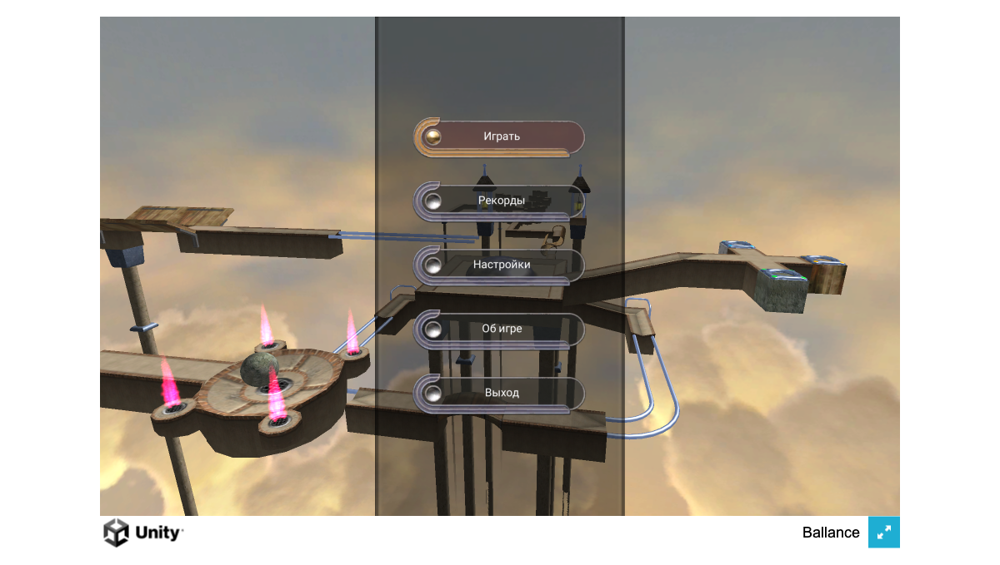
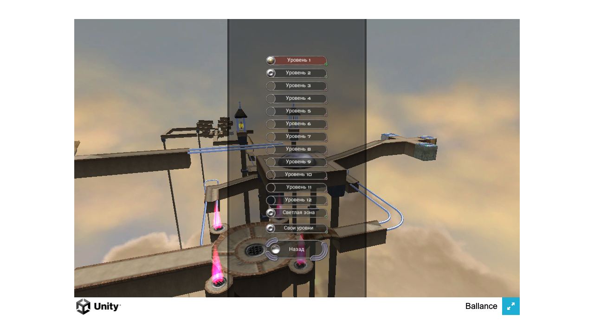
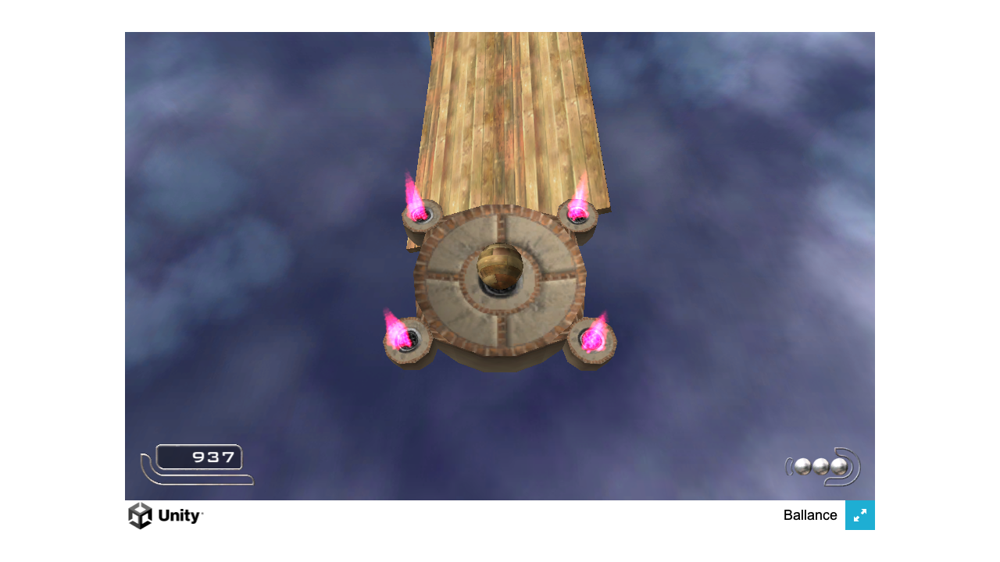
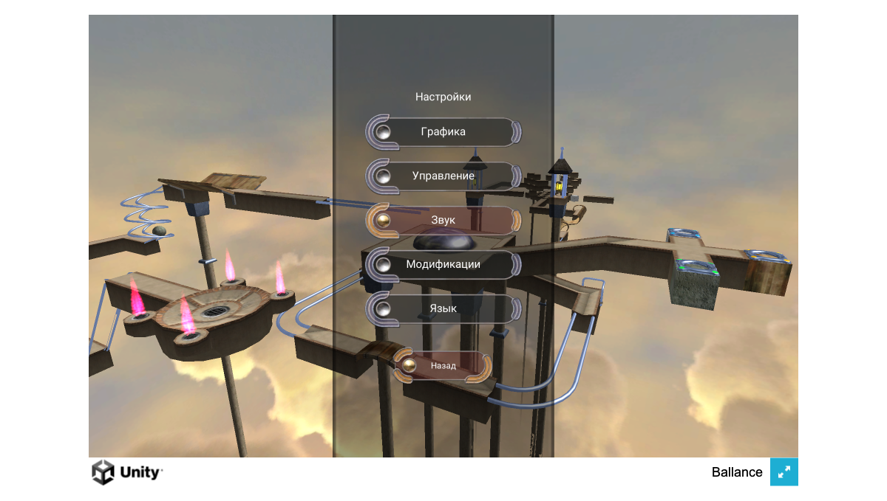
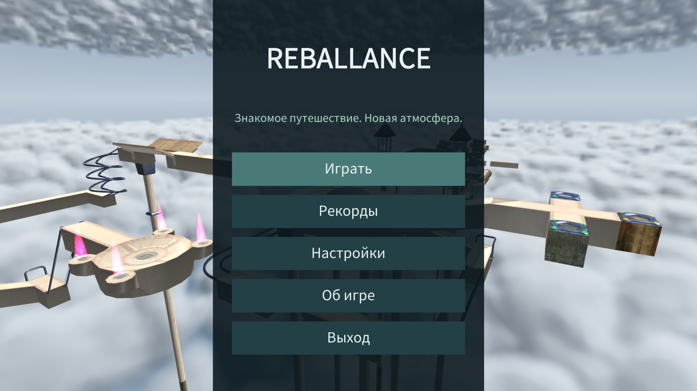
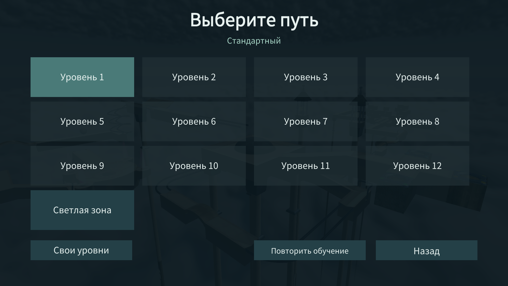
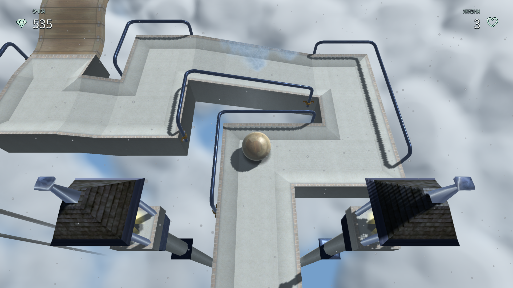
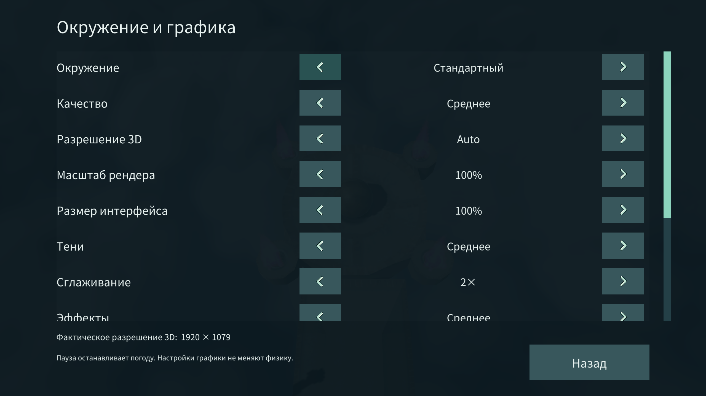

# Ballance & Reballance

A familiar journey above the clouds, with room for something new.

This project continues **[imengyu/Ballance](https://github.com/imengyu/Ballance)**, the open-source Unity recreation of Cyparade's Ballance. Wood, stone and paper balls cross suspended paths, bridges and rails through 13 classic levels. The recreation is preserved as **Ballance**; **Reballance** develops its presentation, interface and environment in a separate branch.

[Play the published game](https://iwonz.github.io/ballance/) · [Downloads](https://github.com/iwonz/ballance/releases) · [Screenshots](#screenshots) · [Development](#development) · [Credits](#credits)

## Two games, two branches

| | Ballance | Reballance |
| --- | --- | --- |
| Purpose | The familiar classic experience | The actively developed reinterpretation |
| Source branch | [`original`](https://github.com/iwonz/ballance/tree/original) | [`main`](https://github.com/iwonz/ballance/tree/main) |
| Direction | Preserve classic visuals, menus, tutorial and mechanics; fix bugs and compatibility | Modern materials, clouds, interface and seven environment presets |
| Source versions | `original/v<version>` | `remaster/v<version>` |
| Current public status | [1.0.11](https://github.com/iwonz/ballance/releases/tag/v1.0.11) | In development; full gameplay acceptance is unfinished |

Both are Unity reconstructions, **not the original commercial Cyparade executable**. They have independent settings and saves; progress is not transferred automatically. Reballance's environment selection does not partition records or change scoring/timer rules.

Ballance's preserved baseline is commit `d066bfe5`, available through both [`v1.0.11`](https://github.com/iwonz/ballance/tree/v1.0.11) and [`original/v1.0.11`](https://github.com/iwonz/ballance/tree/original/v1.0.11). Existing release files stay unchanged. Read the [edition guide](docs/editions.md) for maintenance boundaries.

## Play and download

**Available now:** [play Ballance in the browser](https://iwonz.github.io/ballance/) or [download Ballance 1.0.11](https://github.com/iwonz/ballance/releases/tag/v1.0.11). The public site still serves this classic release. Reballance will be published after the required gameplay acceptance; development screenshots below are not a release announcement.

**The unified release format:** each `release/v<version>` contains **both Ballance and Reballance**, each with its own version, all five platform downloads and SHA-256 checksums. It also contains a complete site archive with the landing and both Web players. Updating one game carries the other game's verified files forward unchanged.

| Platform | Download for either game | Launch |
| --- | --- | --- |
| Web | `<Game>-<version>-WebGL.tar.gz` | Use the shared site, or extract and serve over HTTP |
| Windows x86-64 | `<Game>-<version>-Windows.zip` | Extract the whole archive; run `Ballance.exe` or `Reballance.exe` |
| Linux x86-64 | `<Game>-<version>-Linux.tar.gz` | Extract; run `./Ballance.x86_64` or `./Reballance.x86_64` |
| macOS ARM64 | `<Game>-<version>-macOS.zip` | Extract and move the application to Applications; [first-launch notes](docs/macos-apple-silicon.md) |
| Android ARM64 | `<Game>-<version>-Android.apk` | Install the APK on a compatible device |

The current targets use Windows 10 21H1+, Ubuntu 22.04/24.04, macOS 13.1+ on Apple Silicon, or Android 8.0+. Web requires WebGL 2 and WebAssembly. See [Unity's player requirements](https://docs.unity3d.com/6000.6/Documentation/Manual/system-requirements.html#player) for graphics support. macOS builds are ad-hoc signed, not notarized; Android packages are test-signed. **iOS is deferred.** Historical Intel Mac builds remain in [upstream releases](https://github.com/imengyu/Ballance/releases).

Once the unified release is accepted, the [shared landing](https://iwonz.github.io/ballance/) offers both games. Ballance uses `/ballance/original.html` to preserve existing browser saves; Reballance uses `/ballance/remaster/`. Each player links back to the landing and to the other game. The release's `Ballance-Reballance-<version>-site.tar.gz` contains that same complete site.

Keyboard bindings and touch layouts are available in **Settings → Controls**. Both games retain custom-level packages and built-in mods. External C# DLL mods require Mono desktop builds; Web and Android need their source compiled into the player. The legacy NMO importer requires Windows 32-bit Virtools tooling and is not part of the supported Windows x64 workflow.

## Screenshots

Real captures from local Web players. Click any image for the full-size view. [Capture versions and provenance](docs/images/README.md).

### Ballance · 1.0.11

| Main menu | Level selection |
| --- | --- |
| [](docs/images/ballance-1.0.11-menu.png) | [](docs/images/ballance-1.0.11-levels.png) |
| **Level 2 · gameplay** | **Settings** |
| [](docs/images/ballance-1.0.11-gameplay.png) | [](docs/images/ballance-1.0.11-settings.png) |

### Reballance · 1.0.0-dev.11

Work in progress: presentation, weather tuning and full gameplay acceptance remain under development.

| Main menu | Level selection |
| --- | --- |
| [](docs/images/reballance-dev.11-menu.png) | [](docs/images/reballance-dev.11-levels.png) |
| **Level 1 · Moscow environment** | **Environment and graphics settings** |
| [](docs/images/reballance-dev.11-gameplay.png) | [](docs/images/reballance-dev.11-settings.png) |

## Development

Use **Unity 6000.6.7f1**, exactly as pinned in `ProjectSettings/ProjectVersion.txt`, with the platform modules you need. The project uses the Built-in Render Pipeline, uGUI and native IVP physics. Install Git and Python 3.12+ for the build/release tools; [OpenSpec setup](openspec/README.md#tooling) uses Node and the pinned OpenSpec CLI.

Keep the two Unity projects in separate worktrees:

```sh
git clone https://github.com/iwonz/ballance.git
cd ballance
git switch main
git worktree add .worktrees/original original
```

Open the repository root in Unity for **Reballance**, or `.worktrees/original` for **Ballance**. Each checkout owns its `Library`, `Temp`, `Builds` and native plugins. Never share Unity caches or copy one edition's physics library into the other.

1. Read [AGENTS.md](AGENTS.md), the [source map](docs/architecture.md) and [OpenSpec workflow](openspec/README.md).
2. Open `Assets/Scenes/Main.unity`. On `GameEntry`, set **Debug Type → NoDebug** for the normal game flow, then enter Play mode.
3. Propose and implement changes in the appropriate branch. Shared fixes move as focused, tested `cherry-pick` commits; do not merge the complete edition histories.
4. Run checks selected by [the validation guide](docs/validation.md), record their actual results and archive the OpenSpec change only when its work is complete.

Build from the selected edition's worktree using the content-aware entry point:

```sh
bash scripts/build.sh WebGL
python3 scripts/package-build.py WebGL
```

`macOS`, `Windows`, `Linux` and `Android` are the other release targets. See [build and release instructions](docs/build-and-release.md) for modules, native prerequisites and commands. To test a Web build locally:

```sh
python3 -m http.server 8000 --directory Builds/WebGL
# Open http://localhost:8000/
```

For debugging, click the version in About eight times, accept developer mode and restart. F12 opens the console; `help` lists commands. Use a test profile for commands that change progress or scores.

## Releasing both games

Edition tags identify source versions; **only `release/v<version>` identifies a new public combined release**. The distribution tag belongs to `main`. Its [`site/releases.json`](site/releases.json) pins both source tags and every platform checksum. Unchanged Ballance builds can be reused byte-for-byte while Reballance advances, and vice versa.

The [release procedure](docs/build-and-release.md#github-pages) prepares one upload directory, verifies both games and the attached site, and publishes a single GitHub Release. Pages deploys the exact attached site from that immutable release and checks both public player identities. No build is selected implicitly through “latest”. Roll back one edition by creating a new distribution with its older verified pin and leaving the other unchanged.

The current manifest intentionally has no distribution/Reballance pin. The [active implementation record](openspec/changes/build-original-and-remaster-editions/tasks.md) tracks the unfinished acceptance work; packaging success alone does not authorize publication.

## Documentation

| Guide | Contents |
| --- | --- |
| [Edition maintenance](docs/editions.md) | Branches, source versions, worktrees and save isolation |
| [Architecture](docs/architecture.md) | Capability map, implementation boundaries and known gaps |
| [Build and release](docs/build-and-release.md) | Complete content builds, unified releases, Pages and Mac installation cleanup |
| [Validation](docs/validation.md) | Automated checks, gameplay/device acceptance and performance evidence |
| [OpenSpec](openspec/README.md) | Proposal → specs → design → tasks → implementation → verification → archive |
| [Native physics](BallancePhysics/README.md) | C++/C# bridge and reproducible IVP builds |
| [Translations](HelpTranslate.md) | Localized game resources and rendered UI checks |

Maintained documentation, OpenSpec artifacts and code comments are English. Gameplay localization and original third-party notices retain their own languages.

## Credits

First, **[imengyu/Ballance](https://github.com/imengyu/Ballance)** by **mengyu / Happy Dreamfish (imengyu)**: the upstream Unity recreation this repository was forked from. Both editions build on that work and its contributors' efforts.

**Cyparade** created the original Ballance. **iwonz** maintains this fork and develops Reballance. Native physics derives from [nillerusr/source-physics](https://github.com/nillerusr/source-physics). Thanks also to the bundled tool, UI, compression, font and localization contributors; [CREDITS.md](CREDITS.md) lists their projects and retained notices.

## License and original game rights

The project is maintained for learning purposes. Its code uses [GPL-3.0](LICENSE); third-party components and Ballance game data have separate rights. This applies to **both Ballance and Reballance**. New branding and generated presentation assets do not relicense inherited content. [License boundaries and component notices](CREDITS.md#license-scope).

The upstream notice is preserved verbatim:

> Note: Ballance belongs to Cyparade's work, and the copyright belongs to the original developer Cyparade. The development of this project is for learning purposes only and cannot be used for any commercial purposes. This project follows the GPL-3.0 protocol, but is limited to the code of this project. Any 3D model data, physical engine, images, audio and video, and game data related to Ballance are not within this scope. Any use of these game data for commercial activities without the permission of the copyright owner is illegal.
